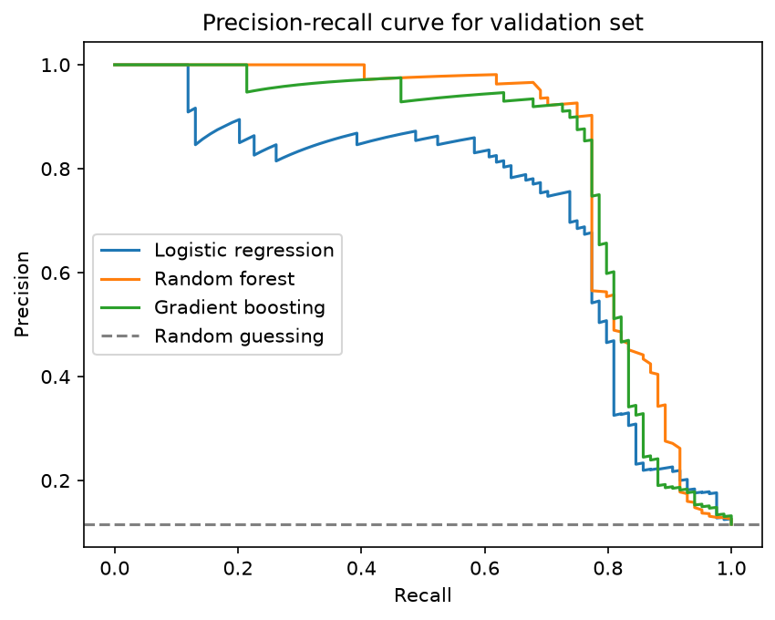

# TOX21-Project
A machine learning project that predicts whether a molecule will be active in each of 12 Tox21 toxicity-related lab assays, using only its chemical structure. Built with Python, RDKit, scikit-learn and SQLite. The full analysis is in `TOX21_Model.ipynb`.

The emphasis of this pipeline is honest evaluation. Molecules are split by scaffold so the test set contains structures the models have not seen, the final model was chosen before the test set was used, and every score is reported next to its random-guessing baseline, with an uncertainty interval for the main result.

## Key results
- On the NR-AR (androgen receptor) assay, the random forest reached a **test AUROC of 0.728** (95% bootstrap interval 0.656 to 0.803) and an **average precision of 0.232** (0.139 to 0.369) on 1,454 held-out molecules, 57 of them active. Random guessing scores about 0.039 on average precision.
- The same random forest, with settings fixed in advance and no per-assay tuning, beat random guessing on all 12 assays. Test AUROC ranged from 0.636 to 0.906.
- Logistic regression, random forest and gradient boosting were too close on the validation set to tell apart, given only 84 active validation molecules.

## Data

- **Tox21** is a US government collaboration (NIH, EPA and FDA) that ran about 7,800 compounds through 12 high-throughput lab assays covering nuclear receptor and stress-response pathways. An assay is a lab experiment that measures one biological effect of a compound. Each label is 1 if the compound was active in the assay and 0 if not, and not every compound was tested in every assay.
- The data is loaded through the [Therapeutics Data Commons](https://tdcommons.ai/) (TDC) Python package, which packages the original Tox21 data in a standard format.
- NR-AR, the assay used for model development, has 7,265 labelled molecules, of which 309 (4.3%) are active.

## Method

1. **Fingerprints.** Each molecule's SMILES string is converted to a 2,048-bit Morgan fingerprint (radius 2) with RDKit. A bit is 1 if a matching substructure is present, which gives every molecule the same fixed-length numerical form.
2. **Scaffold split.** TDC's scaffold split groups molecules by core ring framework and keeps each group in one set, giving 5,085 training, 726 validation and 1,454 test molecules. This is stricter than a random split, which would put near-identical molecules on both sides. The share of active molecules differs between the sets: 3.3% in training, 11.6% in validation and 3.9% in test.
3. **SQLite.** The splits are stored in a SQLite table with a `split` column. A `GROUP BY` query checks the class balance of each split, and the splits are read back with a parameterised `WHERE` query before fingerprinting.
4. **Models.** Logistic regression, random forest (300 trees) and histogram gradient boosting, trained on the training set only. All use `class_weight="balanced"`, because only about 3% of training molecules are active.
5. **Metrics.** AUROC and average precision (AP). Average precision is judged against each set's own random-guessing floor, which is the fraction of active molecules and differs between sets and assays.
6. **Tuning.** A grid search over gradient boosting tree depth (2, 4, 6) and learning rate (0.02, 0.05, 0.1), scored on the validation set only.
7. **Model selection.** The random forest was chosen from the validation scores before the test set was used. The test set was then evaluated once, with no changes afterwards.
8. **Uncertainty.** 95% intervals on the test scores come from 1,000 bootstrap resamples of the test molecules.
9. **Feature importance.** The 15 fingerprint bits the forest relies on most, with how common each is and what fraction of molecules carrying it are active.
10. **All 12 assays.** The assays are stored as two SQLite tables, `molecules` (7,831 compounds) and `labels` (77,946 compound-assay results), linked by `Drug_ID`. A `JOIN` reads one assay back out, and for NR-AR it reproduces the original 7,265 molecules and 309 actives. The same random forest is then trained and tested on every assay, each with its own scaffold split.

## Results

### Validation set (NR-AR, 84 active molecules)

| Model | AUROC | Average precision |
|---|---|---|
| Logistic regression | 0.896 | 0.724 |
| Random forest | 0.912 | 0.834 |
| Gradient boosting | 0.903 | 0.812 |
| Random guessing | 0.500 | 0.116 |

 

The tuning grid gave gradient boosting an average precision between 0.78 and 0.83 and an AUROC between 0.89 and 0.91. The best setting (depth 4, learning rate 0.02) reached 0.828 average precision, about level with the untuned models, so tuning changed little and the differences between models are within the noise.

### Test set, NR-AR (random forest)

| Metric | Score | 95% bootstrap interval | Random guessing |
|---|---|---|---|
| AUROC | 0.728 | 0.656 to 0.803 | 0.500 |
| Average precision | 0.232 | 0.139 to 0.369 | 0.039 |

### Feature importance

The forest's importance is spread across many fingerprint bits, with the top 15 scoring between 0.0075 and 0.0132, so no single bit dominates. Most of them are strongly linked to activity: bit 519, for example, is set in 128 training molecules and 54% of them are active, against a base rate of 3.3%. A few matter mainly through their absence, such as bit 807, which is set in 3,228 molecules of which only 4.3% are active. No claims are made about the chemistry behind these bits (see limitations).

### Test set, all 12 assays (random forest, settings fixed from NR-AR)

Lift is average precision divided by the assay's random-guessing floor, so 1 means no better than chance. The table is sorted by lift, as in the notebook.

| Assay | Test molecules | Test actives | AUROC | Average precision | Random-guessing floor | Lift |
|---|---|---|---|---|---|---|
| NR-AR-LBD | 1,353 | 106 | 0.906 | 0.750 | 0.078 | 9.6 |
| NR-AR | 1,454 | 57 | 0.728 | 0.232 | 0.039 | 5.9 |
| NR-PPAR-gamma | 1,290 | 32 | 0.786 | 0.145 | 0.025 | 5.9 |
| NR-ER-LBD | 1,392 | 111 | 0.762 | 0.458 | 0.080 | 5.7 |
| NR-AhR | 1,311 | 176 | 0.864 | 0.552 | 0.134 | 4.1 |
| SR-HSE | 1,295 | 92 | 0.742 | 0.275 | 0.071 | 3.9 |
| SR-ATAD5 | 1,415 | 68 | 0.723 | 0.170 | 0.048 | 3.5 |
| SR-p53 | 1,356 | 136 | 0.729 | 0.332 | 0.100 | 3.3 |
| NR-ER | 1,239 | 216 | 0.739 | 0.507 | 0.174 | 2.9 |
| SR-MMP | 1,163 | 259 | 0.787 | 0.579 | 0.223 | 2.6 |
| NR-Aromatase | 1,165 | 91 | 0.636 | 0.198 | 0.078 | 2.5 |
| SR-ARE | 1,167 | 238 | 0.702 | 0.408 | 0.204 | 2.0 |

Each assay has its own scaffold split over a different set of molecules, so the rows are not evaluated on identical compounds. With few test actives per assay, differences of a few hundredths, including neighbouring positions in this ordering, are within the noise. Lift also favours assays with few actives, because the highest lift possible is 1 divided by the floor.

## Limitations

- **Assay activity is not human toxicity.** The labels are results from cell-based lab experiments. An active result is an early warning flag that a compound deserves further investigation, not evidence that it is harmful to people.
- **Few active molecules.** NR-AR has 57 test actives, and some assays have fewer. Scores are uncertain, and the bootstrap intervals are probably too narrow because molecules from the same scaffold family are not independent.
- **Validation was more optimistic than test.** NR-AR validation AUROC was 0.912 against 0.728 on test. Validation had an unusually high share of actives (11.6%), and it was used to compare models and tune settings, so its scores are somewhat flattered. The test score is the honest estimate.
- **No per-assay tuning.** All 12 assays use the settings from NR-AR, so some assays might do better with their own.
- **Fingerprint bits are hashed.** Each bit can stand for more than one substructure, so none of the important bits identifies a specific chemical group.

## How to run

```bash
conda create -n tox21 -c conda-forge python=3.11 rdkit pandas scikit-learn matplotlib ipykernel jupyter -y
conda activate tox21
pip install PyTDC "setuptools<81"
jupyter notebook
```

Open `TOX21_Model.ipynb`, select the `tox21` environment as the kernel, and choose Run All Cells. It trains several models and a random forest for each of the 12 assays, so it takes several minutes. Seeds are fixed, so the results should reproduce.

## Data sources and credits

- Tox21 data from the US government Tox21 collaboration (NIH, EPA and FDA).
- Therapeutics Data Commons: Huang et al. (2021). *Therapeutics Data Commons: Machine Learning Datasets and Tasks for Drug Discovery and Development.* NeurIPS Datasets and Benchmarks. [arXiv:2102.09548](https://arxiv.org/abs/2102.09548)
- Built with RDKit, scikit-learn, pandas, NumPy and matplotlib.


